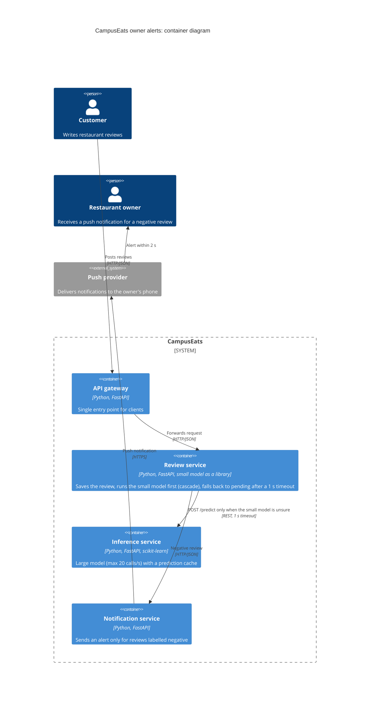

# Task 4: Deployment topologies and trade-offs

**Name / ชื่อ:** ชยุต อาชามงคล

**Student ID / รหัสนิสิต:** 6631307621

This is **individual work**: each student completes and submits their own copy, in their own fork.

*งานนี้เป็น**งานเดี่ยว** นิสิตแต่ละคนทำและส่งงานของตัวเอง ใน fork ของตัวเอง*

**Scenario (A, B or C) / Scenario ที่เลือก:** A (Owner alerts)

Choose **one** scenario below. If the last digit of your student ID is odd, take A or B; if it is even, take B or C. Use your measurements from Tutorial 6 as evidence: cite run names from `results/runs.csv`. Answer in Thai or English.

เลือก scenario **หนึ่ง** ข้อด้านล่าง ถ้าเลขตัวสุดท้ายของรหัสนิสิตเป็นเลขคี่ ให้เลือก A หรือ B ถ้าเป็นเลขคู่ ให้เลือก B หรือ C ใช้ผลการวัดจาก tutorial ที่ทำไปเป็นข้อมูลอ้างอิง โดยอ้างชื่อ run จาก `results/runs.csv` จะตอบเป็นภาษาไทยหรือภาษาอังกฤษก็ได้

Facts that hold in every scenario / ข้อเท็จจริงที่ใช้กับทุก scenario:

- The large model serves at most **20 calls per second** (4 calls at once × about 200 ms each), and every call costs money.

  *large model รับได้สูงสุด **20 calls ต่อวินาที** (พร้อมกัน 4 calls × ประมาณ 200 ms ต่อ call) และทุก call มีค่าใช้จ่าย*
- The small model is fast and cheap enough to run anywhere, including inside the review service or on a kiosk, but it is much less accurate on its own.

  *small model เร็วและถูกพอที่จะรันที่ไหนก็ได้ รวมถึงภายใน review service หรือบน kiosk แต่ถ้าใช้ตัวเดียวจะแม่นน้อยกว่ามาก*

## Scenarios

**A. Owner alerts.** When a customer posts a negative review, the restaurant owner gets a push notification within **2 seconds**. At the lunch peak, CampusEats receives **40 reviews per second**. A missed alert is acceptable, but a wrong alert (for example, "your customer is unhappy" when they are happy) makes owners stop trusting alerts and, in the end, ignore them.

*เมื่อลูกค้าโพสต์รีวิวเชิงลบ เจ้าของร้านจะต้องได้รับ push notification ภายใน **2 วินาที** เวลาช่วงพีคตอนเที่ยง CampusEats ได้รับรีวิวจำนวน **40 รายการต่อวินาที** การพลาด alert ไปบ้างนั้นยอมรับได้ แต่ alert ที่ผิด (เช่น "ลูกค้าไม่พอใจ" ทั้งที่จริงๆ แล้วพอใจ) จะทำให้เจ้าของร้านไม่เชื่อถือและเลิกสนใจ alert ในที่สุด*

**B. Canteen kiosk.** A tablet in each canteen lets students leave a review on the spot. However, the canteen Wi-Fi is poor: the tablets lose their connection several times a day, for minutes at a time. The system must accept every review, even while a tablet is offline. Restaurant owners need the labels **by the end of the day**.

*มี tablet ในแต่ละโรงอาหารให้นิสิตรีวิวได้ทันที อย่างไรก็ดี การเชื่อมต่อ Wi-Fi ในโรงอาหารไม่ดี ทำให้ tablet หลุดการเชื่อมต่อวันละหลายครั้ง ครั้งละหลายนาที ระบบจะต้องรับรีวิวได้ทุกรายการแม้ขณะที่กำลัง offline อยู่ และเจ้าของร้านต้องการ label **ภายในสิ้นวัน***

**C. Weekly report.** Restaurant owners want a weekly sentiment report. Nothing in producing this report has to be real-time. **Accuracy matters most** and **cost must be minimal**.

*เจ้าของร้านต้องการรายงาน sentiment รายสัปดาห์ ไม่มีอะไรที่จะต้องทำแบบ real-time ในการออกรายงานนี้ ความแม่นยำ **(accuracy) สำคัญที่สุด** และ **ค่าใช้จ่ายต้องน้อยที่สุด***

## Topologies and patterns to choose from / Topology และ pattern ที่เลือกใช้ได้

| | Topology | Where the model runs / โมเดลรันที่ไหน |
|---|---|---|
| T1 | Model as a service, synchronous | Inference service, called for each review (today's baseline) *inference service ถูกเรียกทุกรีวิว (baseline ของวันนี้)* |
| T2 | Model as a library | Inside the review service, or on the device *ภายใน review service หรือบนอุปกรณ์* |
| T3 | Hybrid | Small model locally, large model as a remote service *small model รันในเครื่อง large model เป็น remote service* |
| T4 | Asynchronous / batch | Reviews are queued (broker, W10) or stored, and scored later in bulk *รีวิวถูกเข้าคิว (broker, W10) หรือเก็บไว้ แล้วติด label ทีหลังเป็นชุด* |

Combine one topology with any of the patterns from Tutorial 6: **fallback**, **cascade** and **cache**.

*เลือก topology หนึ่งแบบ แล้วผสมกับ pattern จาก Tutorial 6 ได้ตามต้องการ: **fallback**, **cascade** และ **cache***

## 1. Quality requirements

The three most important quality requirements for your scenario, each with a number where possible.

*quality requirements ที่สำคัญที่สุด 3 ข้อของ scenario ที่เลือก ระบุตัวเลขเมื่อทำได้*

| # | Quality | Requirement |
|---|---|---|
| 1 | Performance (latency) | negative review ถึง owner เป็น push notification ภายใน 2 s ที่ 40 reviews/s ช่วง lunch peak |
| 2 | Capacity | ส่งไป large model ได้ไม่เกิน 20 calls/s --> ที่ 40 reviews/s ต้องไปถึง large ไม่เกิน 50% |
| 3 | Accuracy (trust) | alert ต้องถูก label accuracy ≥ 90% (QR3) เพราะ alert ผิดทำให้ owner เลิกเชื่อ ส่วน alert ที่พลาดไปยังรับได้ |

## 2. Design / การออกแบบ

Your topology, the patterns you add, and a container-level diagram (C4 level 2). The C4 diagram must be written in Mermaid.

*topology ที่เลือก pattern ที่เพิ่ม และ diagram ระดับ container (C4 level 2) เขียนด้วย Mermaid*

**Topology:** T3 Hybrid
- small model รันใน review service เป็น library
- large model อยู่ใน inference service เรียกแบบ remote

**Patterns ที่เพิ่ม:**
- **Cascade** (threshold 0.7): small model ตอบเมื่อ confident, เฉพาะตัวที่ไม่แน่ใจถึงไป large
- **Cache** (ใน inference service): ข้อความซ้ำตอบได้เลยไม่ต้องเรียก large
- **Fallback:** large ไม่ตอบใน 1 s --> บันทึกเป็น `pending` และ**ไม่ส่ง alert** (พลาด alert ยอมรับได้ แต่ alert ผิดไม่ได้)

## 3. Evidence / หลักฐาน

Which runs support your choice? Show the numbers and, for scenario A, the capacity arithmetic: how many large-model calls per second does your design need at the peak?

*run ไหนที่สนับสนุนการตัดสินใจของนิสิต ให้นิสิตแสดงตัวเลขประกอบ และสำหรับ scenario A ให้นิสิตแสดงการคำนวณ capacity ด้วย เพื่อแสดงว่าในช่วงพีคนั้น design ของนิสิตต้องใช้ large model กี่ calls ต่อวินาที*

Capacity ที่ peak 40 reviews/s (limit ของ large = 20 calls/s)

| Design | ไป large | Large calls/s | ไม่เกิน 20? |
|---|---|---|---|
| Large only (`t0-large`) | 100% | 40 × 1.00 = 40 | ไม่ผ่าน (2 เท่าของ limit) |
| Cascade 0.7 (`t2-0.7`) | 53% | 40 × 0.53 = 21.2 | ไม่ผ่าน (เกินนิดหน่อย) |
| Cascade 0.7 + cache (`t3-cache`) | 38% | 40 × 0.38 = 15.2 | ผ่าน (76% ของ limit) |

| Run | What it shows / แสดงอะไร |
|---|---|
| t0-large | ต้องใช้ 40 calls/s เป็น 2 เท่าของที่ large รับได้ --> T1 ที่ใช้ large ตัวเดียวไม่รอด (accuracy 93.5% เป็น reference) |
| t2-0.7 | accuracy 93.0% ใกล้ large แต่ไป large 53% = 21.2 calls/s เกิน limit |
| t3-cache | cache ดึงลงเหลือ 38% (hit 35%) = 15.2 calls/s เหลือ headroom 24% accuracy ยัง 93.0% และ p95 557 ms ต่ำกว่า 2 s |
| t2-0.6 | ไป large 38% เท่ากัน แต่ accuracy 91.5% เหนือ 90% แค่ 1.5 จุด เลยเลือก 0.7 + cache แทน |
| t1-after | hang-rate 0.1: timeout 1 s เปลี่ยน 22 errors เป็น `pending` และ run เหลือ 9.6 s (จาก 32.8 s ใน `t1-before`) large ค้างก็ไม่บล็อกระบบ |

ปล. hit 35% มาจาก workload ของ load test ที่มีประโยคสั้น ๆ ซ้ำเยอะ ตอน lunch peak จริงอาจต่ำกว่านี้ ถ้าไม่มี hit เลยต้องใช้ 40 × 0.53 = 21.2 calls/s เกิน limit margin เลยขึ้นกับ cache ล้วน ๆ อีกอย่าง accuracy ที่วัดเป็น accuracy รวม ไม่ใช่เฉพาะ alert ที่ผิด

## 4. ADR

Use the ADR format from W5.

*ใช้รูปแบบ ADR จาก W5*

**Title:** ใช้ Hybrid (cascade + cache + fallback) สำหรับ owner alerts

**Status:** Proposed

**Context:**
- negative review ต้องถึง owner ใน 2 s ที่ peak 40 reviews/s
- large model รับได้ 20 calls/s และทุก call มีค่าใช้จ่าย
- small model เร็วแต่ accuracy แค่ 72.5% (`t0-small`)
- alert พลาดได้ แต่ alert ผิดทำให้ owner เลิกเชื่อ

**Decision:** T3 Hybrid
- small model รันใน review service
- ไป large (ผ่าน inference service) เฉพาะ confidence < 0.7 (cascade) + cache กัน call ซ้ำ
- timeout 1 s --> `pending` และไม่ส่ง alert
- เฉพาะ review ที่ label เป็น negative เท่านั้นที่ส่งไป notification service

**Consequences:**
- Positive: ที่ peak ใช้ large ~15.2 calls/s (`t3-cache`) ไม่เกิน limit 20, accuracy 93.0%, p95 557 ms ผ่าน 2 s ถ้า large ค้าง alert ของตัวที่ไม่แน่ใจจะข้ามไป แต่การ post review กับ alert ของตัวที่ confident ยังทำงาน (`t1-after`)
- Negative: margin ขึ้นกับ cache hit rate ที่วัดจาก test workload เท่านั้น ถ้าไม่มี hit ต้องใช้ 21.2 calls/s เกิน limit, small model ยัง confident ผิดได้ เลยยังมี alert ผิดบ้าง, small model อยู่ใน review service ทำให้ version ผูกกับ deploy ของ service นั้น และมี notification service เพิ่มมาอีกตัว

**Alternatives considered:** at least one topology you rejected, and why.

*อย่างน้อยหนึ่ง topology ที่ไม่เลือก และเหตุผล*

> - **T1 (large model as a service, synchronous):** ไม่เลือก เพราะทุก review ไป large --> 40 calls/s เทียบกับ limit 20 (`t0-large`) และจ่ายเงินทุก call
> - **T4 (asynchronous / batch):** ไม่เลือก เพราะ score ทีหลังเป็นชุดส่ง alert ไม่ทัน 2 s ใช้แนวคิด batch เฉพาะ `pending` ที่ score ทีหลัง
